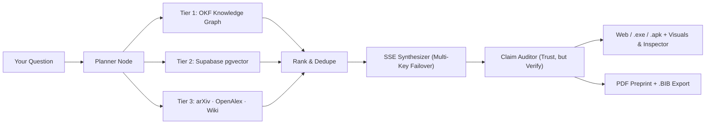

<div align="center">


# ARIA v2.0

**An AI research workspace that actually checks its own homework.**

*(Because citing a hallucinated 2023 Stanford paper in front of your professor is a core memory nobody wants.)*

<br/>

[](https://aria.swarajchattaraj.tech)
[](https://github.com/SWARAJCHATTARAJ/ARIA/releases)
[](https://github.com/SWARAJCHATTARAJ/ARIA/actions/workflows/build-natives.yml)

<br/>


</div>

---

### Wait, what is this?

Most "AI research tools" are just generic GPT wrappers that slap a fake DOI onto a paragraph of made-up trivia and call it a day. When you click the footnote, the paper doesn't exist, the authors never worked together, and the journal was made up on the spot.

**ARIA is built differently.** It doesn't write an answer and hope for the best. It fires a concurrent three-tier retrieval engine, runs every single claim through an entailment auditor before rendering, pulls verified scientific diagrams and quantitative charts directly from Wikimedia Commons and benchmark tables, and exports production-grade academic PDF preprints plus clean `.bib` citation files.

And it runs anywhere: on the **Web**, as a native Windows desktop app (**`.exe`** via Tauri v2), or as an Android app (**`.apk`** via Capacitor) that never boots you out to external browsers.

---

### Stuff that took way too many 2 AM commits

- **Three-tier concurrent retrieval:** Local OKF curated knowledge graph + Supabase `pgvector` RAG + live arXiv / OpenAlex / Wikipedia REST APIs fired in parallel via `asyncio.gather`. Custom timeouts guarantee slow or dead upstream tiers fail fast without freezing the thread.
- **Built-in BS detector (Research Inspector):** A dedicated post-synthesis audit pass evaluates each sentence against actual retrieved passages. It checks for exact quote alignment, flags unsupported numbers, catches retracted papers via Crossref/Retraction Watch sync, and exports clean BibTeX `.bib` files.
- **One-click academic PDFs:** No browser `window.print()` hacks. ARIA generates real single-column preprints with proper LaTeX-to-Unicode math sanitization, formatted Markdown tables, clickable primary source DOIs, verified topic schematics, and 300-DPI publication `matplotlib` plots.
- **Streaming that won't melt your browser:** Real-time Server-Sent Events (SSE) token streaming throttled to ~20fps with debounced auto-scroll so long 2,000-word synthesis runs don't lock your main thread or peg your CPU.
- **API key hot-potato:** Intelligent multi-key pool rotation and instant model failover (`llama-3.3-70b-versatile` &rarr; `llama-3.1-8b-instant`). When Groq returns a `429 Too Many Requests`, ARIA switches keys in <0.5s instead of sleeping for 40 seconds and dropping the connection.
- **Obsidian `#050811` dark mode:** Designed for late-night research marathons. Built from scratch with Obsidian dark tones, mono badges, and zero blinding white canvases (unless you deliberately switch to Light Mode and flashbang yourself).
- **Auth without the headache:** Pure in-app Email + Password authentication powered by Supabase Auth (PKCE flow) alongside GitHub OAuth, plus a zero-friction, rate-limited Guest Mode for anyone who refuses to sign up for yet another account.

---

### How a query survives the pipeline



---

### The Stack

| Layer | Technologies & Tools | Why we picked it |
|---|---|---|
| **Frontend** | React 18, Vite 5, TypeScript 5, Tailwind CSS | Fast HMR, type safety, sub-millisecond styling |
| **Math & Icons** | KaTeX, Lucide React | Real LaTeX equations without mathjax bundle bloat |
| **Backend API** | FastAPI, Python 3.11+, LangGraph, Uvicorn | Async ASGI pipeline with deterministic DAG routing |
| **Inference** | Groq LPU (`llama-3.3-70b-versatile`, `llama-3.1-8b-instant`) | Token generation speeds exceeding 250+ tokens/sec |
| **Vector & Data** | Supabase (PostgreSQL 15 + `pgvector`), FastEmbed (`bge-small-en-v1.5`) | Local ONNX embeddings, zero torch dependency, instant RAG |
| **PDF & Plots** | PyMuPDF (`fitz`), Pillow, Matplotlib (Agg backend) | Native binary PDF generation with crisp 300-DPI charts |
| **Native Apps** | Tauri v2 (Rust, Windows `.exe`), Capacitor 8 (Android `.apk`) | Lightweight native wrappers with locked WebView navigation |
| **Infrastructure** | Vercel (Edge Frontend) + Azure Linux VM (Nginx + systemd) | 99.9% uptime, zero cold-start delay for backend inference |

---

### Run it locally

#### 1. Backend Setup (FastAPI)

```bash
# Clone the repository
git clone https://github.com/SWARAJCHATTARAJ/ARIA.git
cd ARIA/backend

# Create and activate a clean virtual environment
python -m venv venv
# Linux / macOS:
source venv/bin/activate
# Windows PowerShell:
.\venv\Scripts\Activate.ps1

# Install dependencies
pip install -r requirements.txt

# Configure environment variables
cp .env.example .env
```

> [!WARNING]
> **Python 3.12 Compatibility Notice:**
> If you are on Python 3.12+, keep `numpy<2.0.0` (pinned to `1.26.4`) and `matplotlib<3.10` so `langchain-core` and fastembed bindings don't throw a C-extension tantrum during compilation.

Open `backend/.env` and supply your credentials:
```ini
GROQ_API_KEY=your_groq_api_key_here
SUPABASE_URL=https://your-project.supabase.co
SUPABASE_SERVICE_ROLE_KEY=your_service_role_key
JWT_AUTH_ENABLED=false
```

Start the backend:
```bash
uvicorn main:app --reload --port 8000
```

#### 2. Frontend Setup (Vite + React)

```bash
cd ../frontend

# Install dependencies
npm install

# Configure environment
cp .env.example .env
```

Ensure `frontend/.env` points to your local backend:
```ini
VITE_API_URL=http://localhost:8000
VITE_SUPABASE_URL=https://your-project.supabase.co
VITE_SUPABASE_ANON_KEY=your_supabase_anon_key
```

Launch the development workspace:
```bash
npm run dev
```

Visit `http://localhost:5173` to explore the workspace.

---

### Native Builds (`.apk` & `.exe`)

Native build workflows run automatically on GitHub Actions via `.github/workflows/build-natives.yml` whenever code lands on `main`.

#### Required GitHub Actions Secrets
To build native binaries, add these in your repository's **Settings &rarr; Secrets and variables &rarr; Actions**:
- `VITE_API_URL`: Live backend URL (e.g., `https://aria.swarajchattaraj.tech`)
- `VITE_SUPABASE_URL`: Your Supabase public project URL
- `VITE_SUPABASE_ANON_KEY`: Your Supabase anonymous public key

#### Build Android `.apk` Locally (Capacitor)
```bash
# 1. Build the production web bundle
cd frontend
npm run build

# 2. Sync web assets and plugin configurations to Android
cd ..
npx cap sync android

# 3. Compile the debug or release APK with Gradle
cd android
./gradlew assembleDebug  # Windows: .\gradlew.bat assembleDebug

# Output APK location:
# android/app/build/outputs/apk/debug/app-debug.apk
```

#### Build Windows `.exe` Locally (Tauri v2)
```bash
# 1. Build the production web bundle
cd frontend
npm run build

# 2. Compile the standalone Windows installer
cd ..
npx @tauri-apps/cli build

# Output NSIS Installer location:
# src-tauri/target/release/bundle/nsis/ARIA-v2.0.0-windows-setup.exe
```

---

### Production Nginx Snippet (Don't skip this)

If you deploy behind Nginx or an Azure reverse proxy, you **must** disable proxy buffering. Otherwise, Nginx buffers the SSE token stream until the entire 2,000-word answer is finished, totally defeating the purpose of streaming.

```nginx
# /etc/nginx/sites-available/aria
server {
    server_name aria.swarajchattaraj.tech;

    location /api/ {
        proxy_pass http://127.0.0.1:8000;
        proxy_http_version 1.1;

        # Mandatory unless you hate streaming:
        proxy_buffering off;
        proxy_cache off;
        proxy_set_header Connection '';
        chunked_transfer_encoding on;

        # Keep alive long inference and synthesis tasks
        proxy_read_timeout 300s;
        proxy_send_timeout 300s;

        proxy_set_header Host $host;
        proxy_set_header X-Real-IP $remote_addr;
        proxy_set_header X-Forwarded-For $proxy_add_x_forwarded_for;
        proxy_set_header X-Forwarded-Proto $scheme;
    }
}
```

Deploy & restart one-liner on the Azure VM:
```bash
sudo systemctl restart aria-backend && sudo nginx -t && sudo systemctl reload nginx
```

---

### Repo Map

```text
ARIA/
├── .github/
│   └── workflows/
│       └── build-natives.yml    # CI/CD pipeline for Windows .exe & Android .apk
├── android/                     # Capacitor native Android app project & Gradle wrapper
├── assets/                      # Brand assets (logo, high-res icons)
├── backend/
│   ├── pipeline/
│   │   ├── nodes.py             # LangGraph planner, multi-tier retrieval & synthesis
│   │   └── state.py             # Research workflow state definitions
│   ├── utils/
│   │   ├── media.py             # Wikimedia figure fetcher & Matplotlib chart generator
│   │   └── pdf_generator.py     # Academic preprint PDF generator (PyMuPDF)
│   ├── main.py                  # FastAPI server, SSE stream & export endpoints
│   ├── requirements.txt         # Pinned Python dependencies
│   └── .env.example             # Backend environment template
├── data/                        # Static seeds & OKF knowledge base files
├── frontend/
│   ├── public/                  # Static web assets & icons (aria-icon.svg)
│   ├── src/
│   │   ├── components/          # ThreadView, Research Inspector, LoginScreen, Markdown
│   │   ├── context/             # AuthContext (in-app email/password + GitHub PKCE)
│   │   ├── services/            # SSE client, API helpers, Supabase configuration
│   │   └── types/               # TypeScript interfaces & pipeline schemas
│   ├── package.json             # React 18, Vite 5, Tailwind CSS
│   └── vite.config.ts           # PWA & native build bundle configuration
├── infra/                       # systemd unit files & Azure VM setup scripts
├── src-tauri/                   # Tauri v2 desktop shell configuration (Rust)
├── capacitor.config.ts          # Capacitor root config with locked WebView navigation
└── README.md
```

---

<div align="center">

Built by [Swaraj Chattaraj](https://github.com/SWARAJCHATTARAJ)

*Star the repo if you've ever been personally victimized by a fake AI citation.*

</div>
