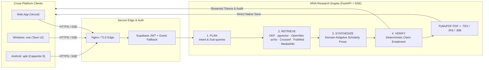

<div align="center">

<!-- HERO BANNER -->
<br />

<h1>✦ ARIA</h1>
<p><strong>Academic Research &amp; Intelligence Architecture — v2.0</strong></p>

<p>
  <em>Citation-verified synthesis, deterministic claim entailment, and publication-grade exports across Web, Windows, and Android.</em>
</p>

<p>
  <a href="https://aria.swarajchattaraj.tech">
    
  </a>
  <a href="https://github.com/SWARAJCHATTARAJ/ARIA/actions/workflows/build-natives.yml">
    
  </a>
  <a href="https://github.com/SWARAJCHATTARAJ/ARIA/releases">
    
  </a>
</p>

<p>
  
  
  
  
  
  
  
  
</p>

<br />

[Launch Web App](https://aria.swarajchattaraj.tech) · [Download Desktop & APK](https://github.com/SWARAJCHATTARAJ/ARIA/releases) · [Architecture](#architecture) · [Quick Start](#quick-start)

</div>

---

## Why ARIA?

Most AI tools generate fluent answers first and treat accuracy as an afterthought. **ARIA** is engineered from the ground up as a **verifiable research instrument**—every response runs through a concurrent multi-tier retrieval and deterministic claim-entailment pipeline, paired with a high-craft editorial interface built for deep reading.

<!-- Add screenshots at docs/assets/workspace-desktop.png and docs/assets/workspace-mobile.png before uncommenting:
<div align="center">
  <table>
    <tr>
      <td align="center" width="66%">
        
        <br />
        <sub><b>Desktop &amp; Web Workspace</b> — Editorial reading canvas &amp; 3-tab Research Inspector</sub>
      </td>
      <td align="center" width="34%">
        
        <br />
        <sub><b>Native Android (.apk)</b> — Obsidian UI &amp; direct Downloads/ARIA export</sub>
      </td>
    </tr>
  </table>
</div>
-->

---

## Core Capabilities

| Capability | What It Does |
| :--- | :--- |
| **4-Stage Verified Pipeline** | Executes `PLAN → RETRIEVE → SYNTHESIZE → VERIFY` in real time over SSE with live kinetic stage indicators and a 25s inactivity stream watchdog. |
| **Click-to-Proof Citations** | Click any inline `[1]` badge to open the **Research Inspector**, jump straight to the primary source card, and highlight the exact supporting `evidence_quote` sentence. |
| **Academic Source Controls** | Scope across **9 discipline branches**, **2 research modes** (`Synthesis` / `Deep Compare`), **Strict Academic** entailment gating, **Peer-Reviewed Only** (OpenAlex, arXiv, Crossref, Semantic Scholar, PubMed), and publication recency (`2Y` / `5Y` / `All`). |
| **Publication-Grade Exports** | Export formatted **Academic Paper** or **Executive Brief** PDFs (PyMuPDF + Unicode/LaTeX math + optional Claim Verification Ledger + Matplotlib plots), Overleaf-ready **`.tex`**, Zotero **`.ris`**, **`.bib`**, **`.md`**, and one-click **APA 7 / IEEE / Chicago / BibTeX** citations. |
| **Curiosity Pathways** | Every report ends with 3 topic-grounded exploration cards—**Deep Dive**, **Counter-View**, and **Applied**—turning answers into structured research loops. |
| **Cross-Platform Native UX** | One unified codebase powering **Web**, **Windows `.exe`** (Tauri v2), and **Android `.apk`** (Capacitor 8 + custom `DirectDownloadPlugin` via `MediaStore.Downloads` into `Downloads/ARIA/`). |
| **Zero-Friction Access** | Instant anonymous guest workspace with in-app **Supabase Email/Password** or **GitHub OAuth** PKCE upgrade—no forced login walls. |
| **4 Curated Themes** | Switch seamlessly between **Cyber Cyan**, **Emerald Biolab**, **Obsidian Gold**, and **Solaris Paper** across Dark, Light, and System surfaces with Serif/Sans typography options. |

---

## Architecture



---

## Security & Engineering Standards

ARIA is built with defense-in-depth across backend services, web clients, and native shells:

- **SSRF & DNS-Rebinding Hardening** — Outbound figure and source fetchers resolve hostnames and re-verify peer socket IPs (`SSRFSafeTransport`), strictly blocking loopback (`127.0.0.0/8`, `::1`), RFC1918 private subnets, non-HTTP(S) schemes/ports, redirects to internal hosts, and cloud metadata IPs (`169.254.169.254`).
- **Strict Input & Rate Controls** — Enforced Pydantic v2 payload bounds, 8 KB query body cap (4 MB for PDF export), per-user and per-IP sliding-window rate limiting (`429 Retry-After`), and hardened HTTP headers (`X-Content-Type-Options: nosniff`, `X-Frame-Options: DENY`, `Referrer-Policy`).
- **Safe Rendering & Error Masking** — Strict URL protocol allowlisting (`https:` / `http:` / `mailto:`), XSS-safe Markdown/KaTeX (`trust: false`) rendering, and correlation-ID error handling that never leaks raw Python stack traces.
- **Automated Native CI/CD** — `.github/workflows/build-natives.yml` compiles signed-ready **Windows `.exe`** (NSIS/Tauri v2) and **Android `.apk`** (Node.js 22, Java 21, Android SDK 36) artifacts on pushes to `main` and version tags.

---

## Quick Start

### Prerequisites

- **Python** `3.11+`
- **Node.js** `22+` & **npm**
- *(Optional for native builds)* **Rust** (`x86_64-pc-windows-msvc`, Tauri v2) & **Java 21 + Android SDK 36** (Capacitor 8)

### 1. Clone & Configure

```bash
git clone https://github.com/SWARAJCHATTARAJ/ARIA.git
cd ARIA
```

<details>
<summary><b>Environment Variables (<code>backend/.env</code> &amp; <code>frontend/.env</code>)</b></summary>

```env
# backend/.env (see backend/.env.example)
GROQ_API_KEY=your_groq_api_key_here
SUPABASE_URL=https://your-project.supabase.co
SUPABASE_SERVICE_ROLE_KEY=your_supabase_service_role_key_here
SUPABASE_JWT_SECRET=your_supabase_jwt_secret_here
JWT_AUTH_ENABLED=false
ENVIRONMENT=development
ALLOWED_ORIGINS=http://localhost:5173,https://aria.swarajchattaraj.tech

# frontend/.env (see frontend/.env.example)
VITE_API_URL=http://127.0.0.1:8000
VITE_SUPABASE_URL=https://your-project.supabase.co
VITE_SUPABASE_ANON_KEY=your_supabase_anon_key
```

</details>

### 2. Run Backend (FastAPI)

```bash
cd backend
python -m venv venv
source venv/bin/activate        # Windows PowerShell: .\venv\Scripts\Activate.ps1
pip install -r requirements.txt
uvicorn main:app --reload --port 8000
```

> [!WARNING]
> **Python 3.12+ Dependency Note:**
> `backend/requirements.txt` pins `numpy<2.0.0` (`1.26.4`) and `matplotlib<3.10` for clean compatibility with `fastembed` and ONNX/LaTeX rendering dependencies.

### 3. Run Frontend (Web / Desktop / Android)

```bash
cd frontend
npm install
npm run dev                      # Web dev server at http://localhost:5173
```

<details>
<summary><b>Build Native Desktop (<code>.exe</code>) &amp; Android (<code>.apk</code>)</b></summary>

```bash
# Build production frontend bundle first
cd frontend
npm run build
cd ..

# Windows desktop binary (Tauri v2, run from repo root)
npx @tauri-apps/cli@^2 build

# Android APK (Capacitor 8, run from repo root)
npx cap sync android
cd android && ./gradlew assembleDebug    # Windows: .\gradlew.bat assembleDebug
```

</details>

---

## Project Structure

```text
ARIA/
├── backend/
│   ├── main.py                  # FastAPI app, SSE streaming, security middleware & /api/export/pdf
│   ├── config.py                # Pydantic settings & CORS origin allowlist
│   ├── pipeline/                # LangGraph state & 4-stage PLAN -> RETRIEVE -> SYNTHESIZE -> VERIFY
│   ├── routers/                 # Auxiliary export (.bib/.ris) and OKF knowledge graph routers
│   └── utils/                   # OpenAlex/arXiv/Crossref/PubMed/MediaWiki search, SSRF guard, media, PyMuPDF PDF
├── frontend/
│   └── src/
│       ├── components/          # ThreadView, 3-tab Research Inspector, 4-section SettingsView, Modals
│       ├── context/             # AuthContext (Supabase PKCE/Guest) & unified SettingsContext (useSettingsStore)
│       ├── services/            # Hardened API client, SSE watchdog parser, storage
│       └── utils/               # Citation formatters (APA 7/IEEE/Chicago/.tex/.ris/.bib), native downloader, haptics, pulse
├── android/                     # Capacitor 8 Android project + DirectDownloadPlugin.java
├── src-tauri/                   # Tauri v2 Windows desktop shell (Rust)
├── data/                        # Curated OKF Markdown ontology notes
├── infra/                       # systemd unit & Azure VM reverse-proxy configuration
└── .github/workflows/
    └── build-natives.yml        # Automated CI/CD for Windows .exe & Android .apk
```

---

## Author

<div align="center">

Built &amp; maintained by **[Swaraj Chattaraj](https://github.com/SWARAJCHATTARAJ)**

<p>
  <a href="https://aria.swarajchattaraj.tech">
    
  </a>
  <a href="https://github.com/SWARAJCHATTARAJ">
    
  </a>
</p>

<sub>If ARIA helped your research workflow, consider starring the repository.</sub>

</div>
